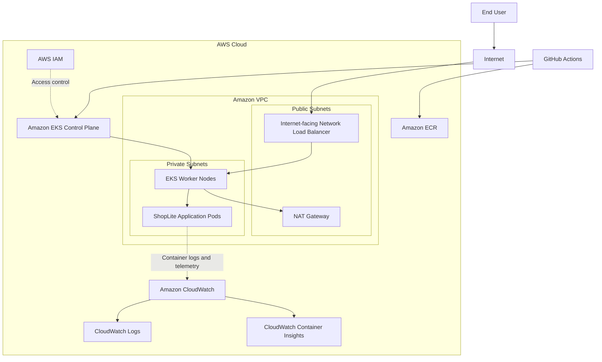

# ShopLite: EKS Microservices DevOps Challenge

ShopLite is a containerized demo application consisting of a frontend and two independent Node.js APIs. The project demonstrates production-oriented DevOps practices, including Infrastructure as Code, automated CI/CD, Kubernetes deployment, container security, AWS infrastructure management, and centralized monitoring.

## Architecture

ShopLite runs on Amazon EKS. Terraform provisions the AWS infrastructure, Docker builds application images, Amazon ECR stores container images, Helm manages Kubernetes application resources, GitHub Actions automates delivery, and Amazon CloudWatch provides centralized observability.

### Infrastructure Architecture



### Key Components

- **Amazon VPC:** Provides network isolation through public and private subnets distributed across multiple Availability Zones.
- **Amazon EKS:** Provides the managed Kubernetes control plane for container orchestration.
- **Amazon EC2 worker nodes:** Run ShopLite application workloads in the configured subnets.
- **Network Load Balancer (NLB):** Provides public network access through the configured Kubernetes Service and AWS load-balancing integration.
- **Amazon ECR:** Stores versioned frontend and backend container images.
- **AWS IAM:** Controls access to AWS infrastructure and services using role-based permissions.
- **Amazon EKS Pod Identity:** Provides workload access to AWS services through Kubernetes service accounts and IAM roles.
- **NAT Gateway:** Provides outbound internet access for private-subnet resources when required.
- **Terraform:** Provisions and manages AWS infrastructure using reusable modules.
- **Docker:** Packages applications and dependencies into container images.
- **Helm:** Packages and deploys Kubernetes resources.
- **GitHub Actions:** Automates validation, testing, security scanning, image publishing, and deployment according to the configured workflows.
- **Amazon CloudWatch:** Provides centralized application logging, Kubernetes and infrastructure metrics, and operational monitoring through the CloudWatch Observability EKS add-on.

### Application Request Flow

1. A user accesses the public application endpoint.
2. The internet-facing NLB receives the incoming connection.
3. The configured NLB target group forwards traffic to the appropriate Kubernetes networking target.
4. Kubernetes Services route requests to the corresponding application pods.
5. The frontend communicates with the backend APIs as required.
6. Application container logs and supported infrastructure telemetry are collected and delivered to Amazon CloudWatch.

### Deployment Flow

1. A developer pushes application or infrastructure changes to GitHub.
2. GitHub Actions runs the jobs configured for the relevant branch, event, and file paths.
3. The pipeline validates the code and runs configured tests and security checks.
4. Docker builds and tags application images.
5. The pipeline authenticates to AWS and publishes images to Amazon ECR.
6. The deployment workflow updates image references and deploys the application using Helm.
7. Kubernetes starts the updated workloads and performs the configured health checks.
8. CloudWatch collects the configured application logs and infrastructure telemetry for centralized monitoring and troubleshooting.

The actual workflow triggers and stages are defined by the GitHub Actions configuration in the repository.

## Design Decisions

- **Amazon EKS:** Provides managed Kubernetes control-plane operations and supports workload orchestration, health checks, and scaling.
- **Custom Terraform modules:** Separate networking, security groups, IAM, EKS, and ECR concerns into reusable components, improving maintainability and reducing duplication.
- **Private worker-node subnets:** Reduce direct public exposure of worker nodes.
- **Network Load Balancer:** Provides Layer 4 load balancing through the configured Kubernetes integration.
- **Docker and Helm:** Docker creates repeatable application images, while Helm provides consistent Kubernetes deployment management.
- **EKS Pod Identity:** Enables workloads to obtain AWS credentials through dedicated IAM roles without distributing long-lived AWS credentials to application containers.
- **Amazon CloudWatch:** Centralizes application logs and infrastructure telemetry, supporting operational troubleshooting and visibility into workload health.
- **Non-root containers:** Reduce container privileges and help limit the impact of a compromised application.
- **GitHub Actions:** Automates delivery and reduces manual deployment operations.
- **Health probes and resource limits:** Help Kubernetes detect unhealthy containers and constrain resource consumption.

## Assumptions

- An AWS account is available with permissions to create and manage the required infrastructure.
- The selected AWS region supports the required EKS, EC2, ECR, networking, and load-balancing resources.
- GitHub Actions has an authorized authentication mechanism for AWS access.
- The application is a demonstration workload and does not require durable business data.
- Public access to the frontend is required for demonstration purposes.
- The deployment uses the Terraform configuration, Helm chart, and workflows included in the repository.
- CloudWatch observability is provisioned and configured through the EKS deployment.

## Prerequisites

Install the following tools for local development and troubleshooting:

- AWS CLI
- Terraform
- Docker Engine and Docker Compose
- kubectl
- Helm
- Git

You also need an AWS account, appropriate deployment permissions, and access to the GitHub repository.

## Deployment

### Automated Deployment

GitHub Actions automates infrastructure provisioning and application delivery according to the configured workflow triggers.

Before running the workflows:

1. Configure the required GitHub repository variables and secrets.
2. Configure AWS authentication for GitHub Actions. GitHub Actions OIDC is preferred over long-lived AWS access keys.
3. Ensure the deployment identity has the required Terraform, ECR, EKS, and Kubernetes permissions.
4. Trigger the workflow through its configured event or manual dispatch option.

Review the workflow files under `.github/workflows/` for their actual triggers, required inputs, and deployment sequence.

### Configure Kubernetes Access

After EKS has been provisioned, configure your local Kubernetes context:

```bash
aws eks update-kubeconfig \
  --region <region> \
  --name <cluster-name>
```

Replace the placeholders with the values used by your Terraform configuration.

### Verify the Deployment

Check application pods, services, and deployments:

```bash
kubectl get pods -n shoplite
kubectl get svc -n shoplite
kubectl get deployments -n shoplite
```

Check rollout status using the actual deployment name from the Helm chart:

```bash
kubectl rollout status deployment/<deployment-name> \
  -n shoplite
```

Obtain the NLB hostname from the relevant Service:

```bash
kubectl get svc -n shoplite
```

Wait for the external hostname to be assigned, then access the application using the protocol and port configured by the Service.

### Verify CloudWatch Observability

Check that the CloudWatch Observability EKS add-on is active:

```bash
aws eks describe-addon \
  --cluster-name <cluster-name> \
  --addon-name amazon-cloudwatch-observability \
  --region <region> \
  --query 'addon.status' \
  --output text
```

Inspect the observability components:

```bash
kubectl get pods -n amazon-cloudwatch
```

List CloudWatch log groups associated with the cluster:

```bash
aws logs describe-log-groups \
  --log-group-name-prefix "/aws/containerinsights/<cluster-name>" \
  --region <region> \
  --query 'logGroups[].logGroupName' \
  --output table
```

These commands help confirm that the add-on is deployed and the expected log groups exist. To confirm end-to-end observability, also check that recent application records and the expected metrics are visible in CloudWatch.

## Run Locally

Requirements: Docker Engine and Docker Compose.

Build and start the application:

```bash
docker compose up --build -d
```

Open `http://localhost:8080` in your browser.

The dashboard displays sample products and orders and supports submitting a demo order.

To stop the containers:

```bash
docker compose down
```

## Container Security

The application uses the following security controls, as implemented in the project:

- Multi-stage Docker builds.
- Node.js APIs run as UID/GID `10001`.
- The frontend uses an unprivileged Nginx image and port `8080`, running as UID/GID `101`.
- Kubernetes security contexts enforce non-root execution.
- Privilege escalation is disabled.
- The root filesystem is read-only where supported by the container configuration.
- Linux capabilities are dropped.
- The `RuntimeDefault` seccomp profile is used.
- CPU and memory requests and limits are configured.
- Readiness and liveness probes are defined.
- Service-account token mounting is disabled where AWS or Kubernetes API access is not required.
- The namespace applies Kubernetes Pod Security `restricted` enforcement.

These controls should be maintained and verified against the actual Dockerfiles, Helm templates, and namespace manifests whenever the application changes.

## Monitoring and Logging

Amazon CloudWatch provides centralized observability for ShopLite running on Amazon EKS. Terraform configures the `amazon-cloudwatch-observability` EKS add-on, which supports CloudWatch Container Insights and centralized telemetry collection.

### Application Logging

Application containers write logs to standard output and standard error. The CloudWatch observability components collect the configured container logs and deliver them to CloudWatch Logs.

Operators can investigate application failures, review runtime behavior, and correlate application events with Kubernetes workload health.

Kubernetes logs can also be inspected directly during troubleshooting:

```bash
kubectl logs -n shoplite deployment/<deployment-name>
```

For previous-container logs after a restart:

```bash
kubectl logs -n shoplite deployment/<deployment-name> \
  --previous
```

### Infrastructure and Container Metrics

CloudWatch Container Insights supports monitoring of relevant EKS infrastructure and workload metrics, including:

- Cluster and worker-node resource utilization.
- Pod and container CPU and memory usage.
- Kubernetes workload health and resource consumption.
- Operational trends that help identify resource pressure and capacity constraints.

The available metrics depend on the deployed add-on configuration and supported collection settings.

### CloudWatch Logs

View log groups associated with the EKS cluster using the AWS CLI:

```bash
aws logs describe-log-groups \
  --log-group-name-prefix "/aws/containerinsights/<cluster-name>" \
  --region <region> \
  --output table
```

Use the CloudWatch console to inspect log streams, search application records, and investigate errors.

### Operational Monitoring

CloudWatch can be used to establish operational alarms for relevant conditions, including:

- High CPU or memory utilization.
- Worker-node or workload health issues.
- Application error rates where suitable metrics are available.
- Unusual changes in infrastructure utilization.

Configure appropriate alarm thresholds, notification targets, and response procedures for the operational requirements of the environment.

### Retention and Cost Management

CloudWatch log groups should have explicit retention policies appropriate to their operational and troubleshooting requirements. Monitor log ingestion, storage, metrics, and other observability charges to control costs.

Monitoring configuration should follow least-privilege IAM principles. The CloudWatch observability components should use their designated IAM role and permissions rather than broad permissions on application workloads.

## Security Considerations

- Prefer GitHub Actions OIDC for short-lived AWS credentials.
- Restrict IAM permissions to the actions and resources required by each workflow.
- Protect the production branch and use approval gates for sensitive deployments.
- Pin third-party GitHub Actions to verified full commit SHAs.
- Scan application images and dependencies for known vulnerabilities.
- Use immutable image tags to improve traceability and prevent accidental tag replacement.
- Configure HTTPS and an appropriate certificate before exposing sensitive application traffic.
- Restrict Kubernetes permissions using least-privilege RBAC.
- Separate infrastructure provisioning permissions from application deployment permissions where practical.
- Use EKS Pod Identity and dedicated IAM roles for workloads that require AWS service access.
- Apply suitable CloudWatch log retention and avoid collecting unnecessary high-volume debug logs.
- Configure appropriate CloudWatch alarms and notifications for important operational conditions.

## Limitations and Future Improvements

- **Demo data:** The APIs use static or in-memory data and do not persist orders.
- **Authentication:** Application authentication and authorization are not implemented.
- **Transport security:** The current demo uses HTTP. Configure TLS, DNS, and suitable traffic restrictions before exposing sensitive application traffic.
- **Alerting:** Refine alarm thresholds, notification targets, and incident-response procedures to meet operational requirements.
- **Observability:** Extend dashboards and alerts with application-specific metrics, request latency, error rates, and service-level objectives where appropriate.
- **CI/CD security:** Add image signing, SBOM generation, vulnerability thresholds, and deployment approval gates.
- **Resilience:** Add application-specific availability tests, recovery procedures, and appropriate scaling policies.
- **Production data:** Introduce managed persistent storage and backup procedures if the application is extended beyond its demonstration purpose.

## Cleanup

If the environment is no longer needed, review the Terraform plan and destroy only the resources managed by the intended Terraform workspace.

Preview the destruction plan:

```bash
terraform plan -destroy
```

Destroy the resources after reviewing the plan:

```bash
terraform destroy
```

Run these commands from the correct Terraform root directory and workspace. Confirm that the plan does not include resources you need to retain before approving destruction.
